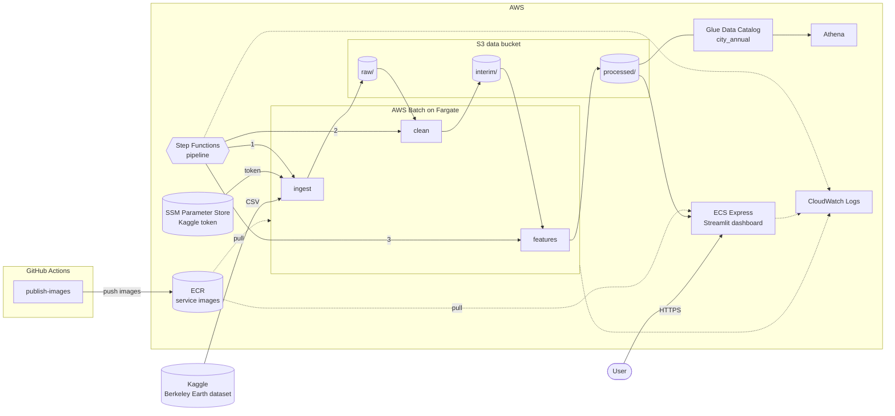

# `global-climate`

[](https://github.com/eliasduerr/global-climate/actions/workflows/ci.yml)

The `global-climate` repository defines an AWS infrastructure for cleaning and aggregating global climate data from Berkeley Earth's Kaggle dataset.
It furthermore visualizes the resulting climate features in a Streamlit dashboard.

## Architecture



## Pipeline

A Step Functions state machine runs three containerized batch jobs in sequence. Each one reads the previous stage's output from S3 and writes Parquet to the next prefix. A dashboard serves the result.

| Stage | Reads | Writes | Does |
| --- | --- | --- | --- |
| [ingest](services/ingest/README.md) | Kaggle | `raw/` | Downloads the Berkeley Earth city temperatures and validates the schema. |
| [clean](services/clean/README.md) | `raw/` | `interim/` | Parses types, makes city names unique, drops pre-1850, high-uncertainty and missing months. |
| [features](services/features/README.md) | `interim/` | `processed/` | Computes annual means of complete years and the anomaly against each city's 1951–1980 mean. |
| [dashboard](services/dashboard/README.md) | `processed/` | – | Streamlit app with the global mean anomaly, a map of city trends since 1950 and a city drill-down. |

All batch stages use Polars lazily (`scan_parquet` → `sink_parquet`) and validate their output against a fixed schema, so a stage fails early instead of passing bad data on.

## Repository layout

```
services/
  ingest/      batch job: Kaggle → raw/
  clean/       batch job: raw/ → interim/
  features/    batch job: interim/ → processed/
  dashboard/   Streamlit app on ECS Express
infra/         Terraform for all AWS resources
.github/
  workflows/   CI (pre-commit + tests) and image publishing to ECR
```

Each service is its own `uv` project with a `pyproject.toml`, a `uv.lock`, a `Dockerfile` and tests.

## Prerequisites

- An AWS account and credentials for the AWS CLI
- [Terraform](https://developer.hashicorp.com/terraform) ≥ 1.6
- [uv](https://docs.astral.sh/uv/) (Python 3.13 is installed automatically)
- Docker, to build images locally
- A [Kaggle API token](https://www.kaggle.com/settings)

## Deployment

All commands run from the repository root. The defaults deploy to `eu-central-1` with the project name `global-climate` (Terraform variables `aws_region` and `project`). If you change them, also update `AWS_REGION` and `ECR_NAMESPACE` in [publish-images.yml](.github/workflows/publish-images.yml).

### 1. Store the Kaggle token

The token is kept out of Terraform state and is stored in SSM Parameter Store, where only the ingest job may read it:

```sh
aws ssm put-parameter --name /global-climate/kaggle/token --type SecureString --value '<token>'
```

### 2. Create the ECR repositories and push images

The Batch job definitions and the dashboard pin their images by digest, so the images must exist before the full `terraform apply`. On a fresh account, create the repositories first:

```sh
terraform -chdir=infra init
terraform -chdir=infra apply -target=aws_ecr_repository.service
```

Then push the images, either through the [publish-images](.github/workflows/publish-images.yml) workflow (see [CI/CD](#cicd)) or by hand:

```sh
REGISTRY=$(aws sts get-caller-identity --query Account --output text).dkr.ecr.eu-central-1.amazonaws.com
aws ecr get-login-password --region eu-central-1 | docker login --username AWS --password-stdin "$REGISTRY"
for s in ingest clean features dashboard; do
  docker build --platform linux/amd64 -t "$REGISTRY/global-climate/$s:latest" "services/$s"
  docker push "$REGISTRY/global-climate/$s:latest"
done
```

`--platform linux/amd64` matters on Apple Silicon, because the Fargate tasks run on x86_64.

### 3. Deploy the infrastructure

```sh
terraform -chdir=infra apply
```

### 4. Run the pipeline

The pipeline has no schedule; start it manually:

```sh
aws stepfunctions start-execution --state-machine-arn "$(terraform -chdir=infra output -raw state_machine_arn)"
```

Progress is visible in the Step Functions console, and the job logs are in CloudWatch under `/aws/batch/global-climate-<stage>`.

### 5. Open the dashboard

```sh
terraform -chdir=infra output dashboard_endpoints
```

### Rolling out new images

Terraform resolves the `latest` tag to a digest when it runs. Pushing new images alone doesn't change what is deployed, so run `terraform -chdir=infra apply` again afterwards. To deploy a specific tag, e.g. a commit SHA, pass `-var 'image_tags={ingest="<sha>"}'`.

## Querying with Athena

The processed layer is registered in the Glue Data Catalog as `global_climate.city_annual`. For example, the ten fastest-warming cities since 1950:

```sql
SELECT country, city, regr_slope(temperature_anomaly, year) * 10 AS trend_per_decade
FROM global_climate.city_annual
WHERE year >= 1950
GROUP BY country, city
ORDER BY trend_per_decade DESC
LIMIT 10;
```

Athena needs a query result location, which is not part of this Terraform setup. Set one in the workgroup settings before the first query.

## Local development

```sh
uv tool install pre-commit
pre-commit install            # ruff, terraform fmt/validate, uv lock checks, ...

cd services/<service>
uv sync
uv run pytest                 # add -m "not slow" to skip property-based tests
```

All stages read their input and output paths from environment variables, which also accept local file paths. That makes it easy to run the whole pipeline locally without AWS. `data/` is gitignored:

```sh
mkdir -p data
(cd services/ingest   && KAGGLE_API_TOKEN=<token> RAW_OUTPUT_PATH=../../data/raw.parquet uv run main.py)
(cd services/clean    && RAW_INPUT_PATH=../../data/raw.parquet CLEAN_OUTPUT_PATH=../../data/interim.parquet uv run main.py)
(cd services/features && CLEANED_INPUT_PATH=../../data/interim.parquet FEATURES_OUTPUT_PATH=../../data/city-annual.parquet uv run main.py)
(cd services/dashboard && PROCESSED_URI=../../data/city-annual.parquet uv run streamlit run main.py)
```

The `.env.example` file in each service lists the variables for running against an S3-compatible store such as MinIO.

## CI/CD

- **[CI](.github/workflows/ci.yml)** runs on every push and on pull requests to `main`. It runs all pre-commit hooks and, for each service, `uv sync --frozen` followed by `pytest`.
- **[publish-images](.github/workflows/publish-images.yml)** runs after CI succeeds for a push to `main`, and on manual dispatch. It builds all four images and pushes them to ECR, tagged with the tested commit's SHA and `latest`. It authenticates through GitHub OIDC and needs two repository secrets:
  - `AWS_ACCOUNT_ID`
  - `AWS_CI_ROLE_ARN`: an IAM role that GitHub Actions may assume and that can push to the ECR repositories. This role is not managed by this Terraform setup.

## Design decisions

- **AWS Batch on Fargate instead of Lambda.** Ingest downloads and converts a CSV of several hundred megabytes. Batch jobs aren't bound by Lambda's 15-minute limit, and Fargate lets each stage size its CPU, memory and disk. Fargate *Spot* cuts the compute cost; interrupted jobs are retried.
- **Step Functions for orchestration.** The `submitJob.sync` integration waits for each job to finish and retries failures with exponential backoff (three attempts). Each run also gets an inspectable execution history.
- **Layered Parquet storage (`raw/` → `interim/` → `processed/`).** Each stage can be re-run on its own, and each task role can only read its input prefix and write its output prefix.
- **Schema contracts between stages.** Every stage validates its output with `match_to_schema`, and the processed schema is mirrored by the Glue table.
- **Climate methodology.** Using only complete years cancels the seasonal cycle. Anomalies against each city's 1951–1980 mean (the Berkeley Earth / NASA GISS reference period) make cities with very different climates comparable. Gaps are dropped rather than interpolated, because linear interpolation ignores the seasonal cycle.
- **Networking without a NAT gateway.** Tasks run in public subnets with a public IP and security groups that allow only outbound HTTPS and DNS. An S3 gateway endpoint keeps S3 traffic inside the VPC. This avoids the fixed cost of a NAT gateway; a production setup would use private subnets.
- **Images pinned by digest.** A deployment always runs exactly the image Terraform resolved, even if `latest` moves.

### Demo-only settings

These choices keep the project cheap and easy to tear down. They are marked in the Terraform code and should be changed for production:

- S3 objects expire after 7 days, and bucket versioning is disabled.
- `force_destroy` / `force_delete` are set on the bucket and the ECR repositories.
- ECR keeps only the last three tagged images.
- Terraform state is stored locally (no remote backend).

## Cost and teardown

Batch jobs only cost money while they run. The dashboard runs continuously: at least one Fargate task plus the load balancer that ECS Express provisions. It is the main fixed cost.

Because of the 7-day expiry, the dashboard fails to load data a week after the last pipeline run; start the pipeline again to refresh the data.

To remove everything:

```sh
terraform -chdir=infra destroy
aws ssm delete-parameter --name /global-climate/kaggle/token
```

## Data source and licence

The data is the [Berkeley Earth Surface Temperature dataset](https://www.kaggle.com/datasets/berkeleyearth/climate-change-earth-surface-temperature-data) published on Kaggle under [CC BY-NC-SA 4.0](https://creativecommons.org/licenses/by-nc-sa/4.0/). See [berkeleyearth.org](https://berkeleyearth.org) for the underlying methodology.
